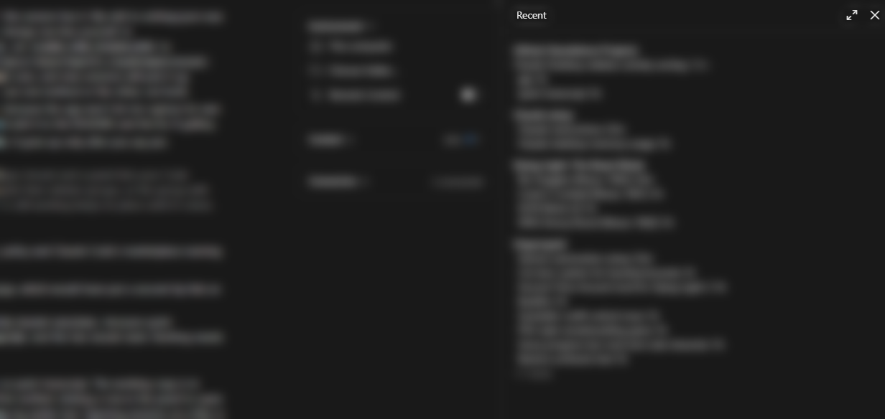

# recent-sessions

A Claude Code mod for the Claude desktop app. It adds a Recent panel to the Code tab that lists your sessions by when each one last finished, inside their sidebar groups, with the group that finished most recently at the top.



The app's sidebar sorts the sessions in a group by last activity, and that time keeps moving while a session works. So when several sessions are busy and one finishes, the finished one drops below the ones still running. The groups themselves stay in the order you dragged them into. Mods can't reorder the sidebar, so this panel gives you a second view of it:

- When a session finishes, it moves to the top of its group, and its whole group moves to the top of the panel.
- A session that's still working keeps its place and shows "working". It moves up once it's done.
- Sessions stay in their sidebar groups, pinned ones included. Ungrouped ones sit together under "Ungrouped".
- Click a session to open it, as you would in the sidebar. A session that finished under a minute ago shows "now" in green.

Type `/recent` to open or close the panel. While you leave it open, new sessions open it too, and a session that was already running opens it the next time you send it a message. Closing it in any session turns that off.

The session list comes from the desktop app, so the panel only works in its Code tab. In a terminal session it says so and stays empty. It needs a Claude Code version that runs mods; it was built and tested on 2.1.308 with desktop app 3.6556.

## Install

At the prompt of a terminal session:

```
/plugin install recent-sessions --marketplace kevlar10x/recent-sessions
```

Answer `y` to add the marketplace, then pick the user scope.

From a shell:

```bash
claude plugin install recent-sessions --marketplace kevlar10x/recent-sessions
```

In the desktop app, where `/plugin` doesn't run: click **+** next to the prompt box, then **Plugins**, **Add marketplace** with `kevlar10x/recent-sessions`, then **Add plugin**.

## How much it costs to run

The panel reads the session list only while it's open and an app window shows its session: every 3 seconds while any session is working, every 8 seconds when none is. It reads the session it sits in only when that one can have changed: after a prompt, when a turn ends, while it works, and otherwise every 30 seconds. When you switch to another session, the app detaches the window and the panel stops completely, then reads the list again the moment you come back. That comes to at most 22 calls to the app a minute while a session works, 10 when none is, and none while you look at another session.

It redraws only when something it shows has changed, and it keeps nothing but that list and one timestamp per session.

## Privacy

The panel reads your sessions' titles, sidebar groups, working state, last activity times and app links from the desktop app. In the mod's own storage on your computer, each session's panel saves the finish times it saw under its own entry, so panels in different sessions never write over each other, and the mod saves whether you last left the panel open. An entry is removed once its panel hasn't saved for two weeks. It makes no network requests. Clicking a session hands its `claude://` link to Windows Explorer (`open` on macOS), which passes it to the desktop app.

## What it calls and runs

While the panel is open and its session is on screen, the mod calls two tools of the desktop app's own session server (`ccd_session_mgmt`) on its own timer, without Claude asking for them: `list_sessions` (up to 60 sessions) and `get_session` for the session the panel is in. They give titles, sidebar groups, working state, last activity times and `claude://` links.

Both only read, and they talk to the desktop app on your computer. The mod sends nothing anywhere and fetches nothing from the network.

The one program it starts is the system's link opener, and only when you click a session: `explorer.exe <link>` on Windows, `open <link>` on macOS. `<link>` is that session's `claude://claude.ai/epitaxy/...` link from the app, and the mod checks it against that exact pattern first.

It also hooks a few events, and passes each one on unchanged:

- `prompt.submit`: opens the panel in that session if you last left it open, and notes that the session's own row needs reading again.
- `turn.complete`: notes the same when a turn ends.
- `session.detach` and `session.attach`, which the app raises when you switch away from the session and back: stops and restarts the reading.
- `ui.close`: stops the reading and remembers that you closed the panel.

## Limits

- Tested on Windows. Opening a session from the panel on macOS hasn't been tested.
- The app's session list doesn't say when a session is waiting for your answer or approval, so a session stopped at a question may still show as working.
- It lists your 60 most recent sessions, up to 8 per group, and counts the rest as "+n more".
- If you rename the session the panel is in, or move it to another group, its own row can take up to 30 seconds to show that.

## Uninstall

```bash
claude plugin uninstall recent-sessions
```

## License

MIT, by kevlar10x. The original is at https://github.com/kevlar10x/recent-sessions.

More mods by kevlar10x: [status-dots](https://github.com/kevlar10x/status-dots) shows how each session ended with a colored dot in its title, and [quiet-transcript](https://github.com/kevlar10x/quiet-transcript) fades everything in the transcript except Claude's answers.

If you'd like to leave a tip: https://ko-fi.com/kevlar10x
